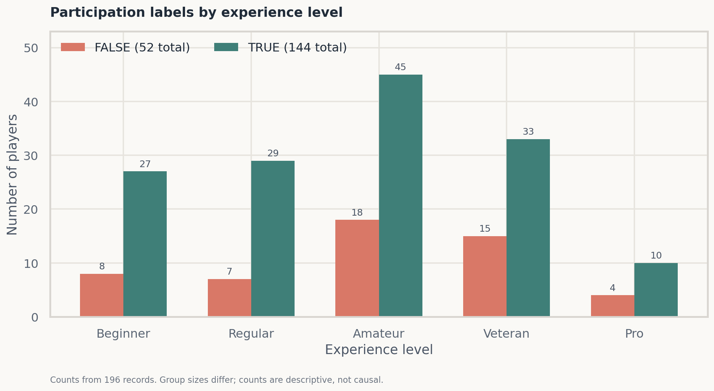
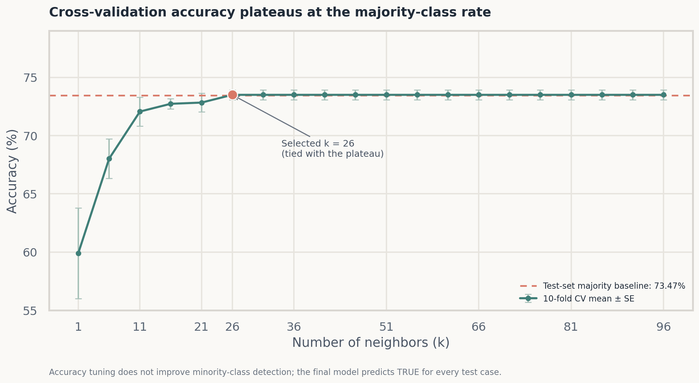
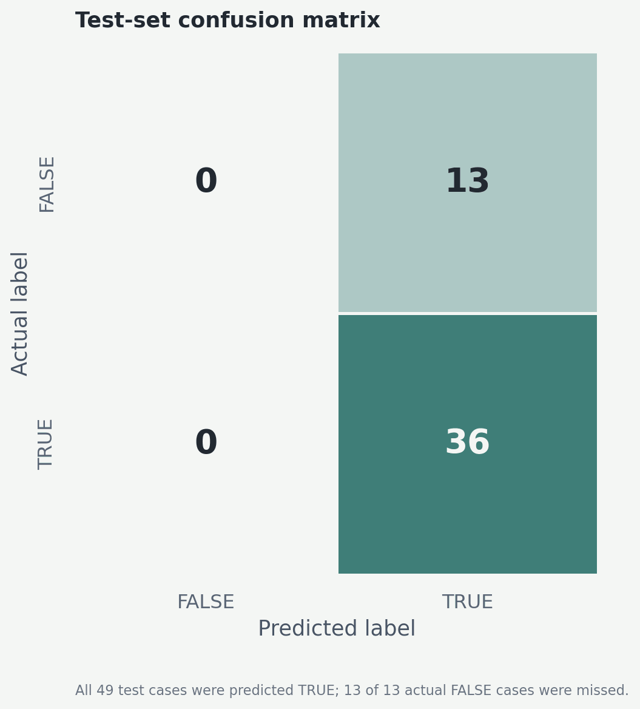

# Predicting Player Retention on a Research Minecraft Server
## 用玩家历史参与数据探索持续参与预测

[English](README_EN.md) · 简体中文

本项目使用 UBC 计算机科学研究团队提供的研究 Minecraft 服务器玩家数据，探索一个实际运营问题：**能否根据玩家的过往信息，识别哪些人会继续参与服务器？**

项目构建了一个 k-近邻（k-NN）分类基线，使用玩家游戏时长、经验等级、年龄和性别预测 `subscribe`（是否继续订阅/参与）。分析包含数据清理、探索性图表、特征标准化、分层训练/测试划分、10 折交叉验证调参和混淆矩阵评估。

> **最重要的结果**：最佳交叉验证参数为 (k=26)，测试集准确率为 **73.47%**。但混淆矩阵显示，模型把测试集的 49 位玩家全部预测为 TRUE：36 位 TRUE 判断正确，13 位 FALSE 全部被错判。由于测试集里 TRUE 本身占 36/49 = **73.47%**，模型的准确率与“永远预测多数类 TRUE”的基线相同，Cohen’s (kappa=0)。因此，这个项目的关键结论是：**单看 accuracy 会高估模型表现；当前 k-NN 基线没有识别出非订阅玩家，不能用于实际流失识别。**

## 研究问题与业务背景

研究团队希望了解玩家会不会持续参与，以辅助服务器资源安排和后续招募。项目将问题具体化为二分类任务：

> 给定玩家在研究服务器上的过往参与及基础信息，模型能否预测 `subscribe` 为 TRUE 或 FALSE？

这类模型的业务价值取决于它是否能识别目标人群。如果目标是发现可能停止参与的玩家，那么只把大多数玩家判为“会继续参与”，即使总体准确率看起来不低，也无法支持定向招募或留存干预。因此，项目同时检查分类结果和混淆矩阵，而没有只报告 accuracy。

## 数据

- **来源**：UBC 计算机科学研究团队提供的研究 Minecraft 服务器数据。
- **样本**：196 条玩家记录，原始文件包含 9 列。
- **目标变量**：`subscribe`，TRUE / FALSE。
- **特征**：`played_hours`（累计游玩小时数）、`experience`（经验等级）、`age`（年龄）、`gender`（自报性别）。
- **预处理**：移除姓名、hashed email 和空标识符列；将分类变量转为 factor；对数值特征中的缺失值使用该列中位数填补。
- **类别比例**：全数据包含 144 个 TRUE 和 52 个 FALSE，TRUE 占 73.47%。

仓库当前提交的是分析 notebook，没有提交原始 `players.csv`。Notebook 中原数据通过研究团队提供的外部链接读取；访问权限和数据可再分发状态由数据提供方决定。请勿从输出示例或 notebook 中推断个人玩家身份。

## 分析流程

1. **清理并整理字段**：保留参与状态、游玩时长、经验、年龄和性别；移除姓名、哈希邮箱及无信息标识列。
2. **探索数据**：绘制游玩时长与年龄的散点图，并比较不同经验等级、性别下 TRUE/FALSE 的人数分布。
3. **分层拆分数据**：使用固定随机种子 `2000`，以 `subscribe` 为分层变量，将 75% 数据用于训练、25% 用于测试。测试集在模型选择阶段不参与训练。
4. **标准化数值特征**：在 tidymodels recipe 中缩放并中心化数值预测变量，避免游玩小时、年龄等量纲差异主导距离。
5. **交叉验证调参**：在训练数据上进行 10 折分层交叉验证；对 (k=1,6,11,ldots,96) 等候选邻居数比较平均 accuracy。
6. **测试集评估**：使用选出的 $k$ 拟合最终 k-NN 模型，在留出的测试集计算 accuracy、Cohen’s (kappa) 并检查混淆矩阵。

### 建模设置

| 项目 | 设置 |
| --- | --- |
| 算法 | k-Nearest Neighbors 分类器（k-NN） |
| 输入变量 | `played_hours`、`experience`、`age`、`gender` |
| 目标变量 | `subscribe`（TRUE / FALSE） |
| 数值处理 | 训练集 recipe：scale + center |
| 切分方式 | 75% train / 25% test；按 `subscribe` 分层；seed = 2000 |
| 调参方式 | 训练集内 10-fold stratified cross-validation |
| 选择指标 | 交叉验证平均 accuracy |
| 最优候选 | (k=26) |

## 具体结果：准确率为什么会误导

Notebook 记录的交叉验证平均 accuracy 在 (k=26) 时达到 **73.50%**；测试集 accuracy 为 **73.47%**。如果只看这两个数，会误以为模型可以较稳定地预测持续参与。

但测试集的混淆矩阵揭示了实际行为：

| 实际值 \ 预测值 | FALSE | TRUE |
| --- | ---: | ---: |
| FALSE | 0 | 13 |
| TRUE | 0 | 36 |

模型对每一条测试样本都预测 TRUE，没有一次预测 FALSE。因此：

- 对 TRUE 类：precision = (36/49) = **73.47%**；recall = (36/36) = **100%**。
- 对 FALSE 类：recall = (0/13) = **0%**。
- Cohen’s (kappa) = **0**，表示结果没有超越基于类别比例的随机一致性基准。
- 一个简单的多数类基线——每次都预测 TRUE——在该测试集上同样得到 (36/49 = 73.47%) accuracy。

Notebook 中计算的 TRUE 类 F1 约为 **0.85**，但它不能代表模型兼顾了两类：模型完全没识别出 FALSE。若运营目标是找出可能停止参与的人，这种模型会漏掉所有实际 FALSE 个案。报告中原先把 recall=1 解读为“识别所有可能流失玩家”也不成立：正类定义是 `subscribe=TRUE`，该 recall 衡量的是识别 TRUE，而不是 FALSE / churn。

**解释**：交叉验证挑选了 accuracy 较高的 $k$，但目标类别分布不平衡，且当前特征与 k-NN 决策边界不足以识别少数类。数据规模只有 196 条，测试集仅 49 条，结论应视为课堂项目中的探索性基线，而非上线效果。

## 图表与可视化

以下图表根据 notebook 中已保存的统计汇总、交叉验证结果和测试集混淆矩阵重绘，方便快速查看核心分析。人数图用于描述样本分布；交叉验证图同时标出测试集多数类基线；混淆矩阵展示模型实际预测行为。

### 经验等级与参与状态



不同等级中的 TRUE 人数均多于 FALSE，但该图展示的是样本人数，不是各等级的订阅概率；各组人数不同，也不能据此推断因果关系。

### k-NN 调参结果



随着 $k$ 增大，交叉验证 accuracy 在约 73.5% 处进入平台。红色虚线为测试集多数类基线 73.47%；曲线与基线接近，提示高 accuracy 主要反映 TRUE 多数类比例，不能单独说明模型识别了 FALSE 玩家。误差线表示 10 折交叉验证标准误。

### 留出测试集混淆矩阵



模型没有预测出任何 FALSE：13/13 个实际 FALSE 样本均被漏掉。这是判断该模型能否用于识别潜在不再参与玩家时最重要的结果。

打开 [分析 Notebook](https://github.com/ychen393/Video-Game-Player-Engagement-Behavioral-Analysis-/blob/main/project%20final%20report.ipynb) 可查看原始代码、其他 EDA 图、完整交叉验证曲线和模型输出。

## 结论与下一步

该模型可以作为“从数据清理到模型评估”的 k-NN 基线案例，但测试结果没有证明有效的玩家留存预测能力。更有价值的发现是评估流程暴露了指标和业务目标之间的错位：accuracy 达到 73.47%，实际却等同于多数类基线，且少数类召回率为 0。

若继续迭代，建议：

1. 以识别 FALSE 玩家为目标明确正类定义，并报告少数类 recall、precision、specificity、balanced accuracy、PR-AUC 等指标。
2. 在训练数据内尝试类别权重或重采样，同时保留独立测试集，避免信息泄漏。
3. 纳入更具行为含义的字段，例如登录频率、最近一次活动时间、连续活跃天数和参与研究任务次数；当前数据只有累计游玩小时和少量人口统计变量。
4. 与多数类基线、逻辑回归、决策树/随机森林等方法比较，并使用重复交叉验证评估小样本下的稳定性。
5. 在数据提供方许可下获取更多样本，并检查不同年龄/性别组的误差差异，避免小样本下的偏差被掩盖。

## 技术栈

- **语言**：R 4.3.3
- **建模与数据处理**：tidyverse、tidymodels、recipes、kknn
- **可视化**：ggplot2、RColorBrewer、GGally
- **分析形式**：R Jupyter Notebook

## 如何查看和复现

### 查看完整报告

在 GitHub 上打开：

[project final report.ipynb](https://github.com/ychen393/Video-Game-Player-Engagement-Behavioral-Analysis-/blob/main/project%20final%20report.ipynb)

Notebook 包含分析说明、R 代码、图表和已保存的执行输出。若需从头运行，请使用 R 4.3.3，并安装 notebook 中加载的 R 包（tidyverse、tidymodels、RColorBrewer、ggplot2、GGally 等）。数据访问需要有效的原始数据链接和提供方权限。

### 仓库文件

```text
README.md
project final report.ipynb
```

## 合作者

Catherine Zhao · Hannah Zhao · Bowen Zhu · **Winnie Chen**

## 说明

这是 UBC 课程项目，使用研究团队提供的数据进行学术分析。模型输出是探索性结果，不构成关于个体玩家的确定判断，也不适用于直接部署的留存运营决策。
